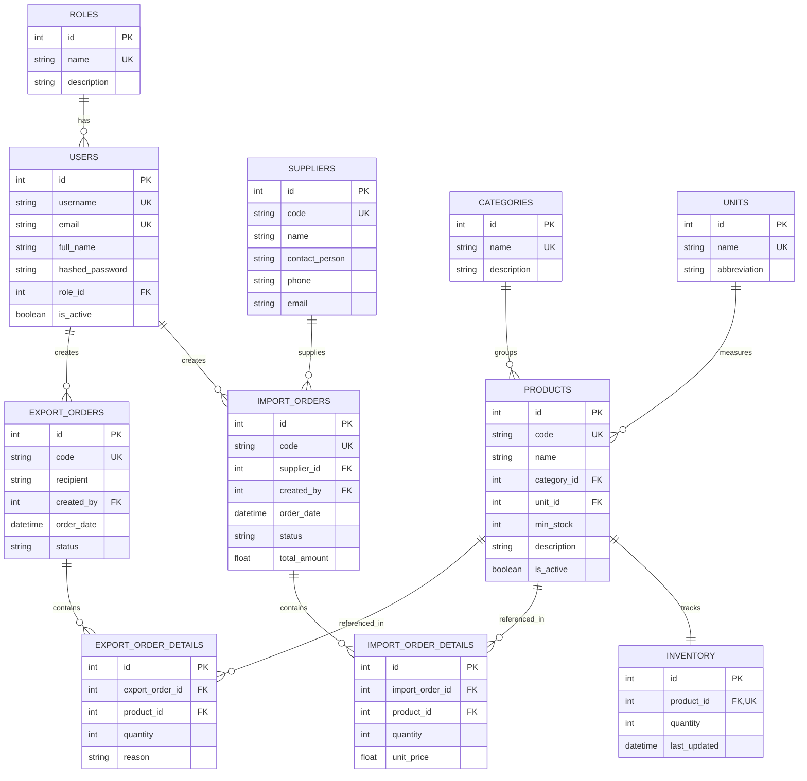

# BÁO CÁO THIẾT KẾ HỆ THỐNG & MINH CHỨNG SỬ DỤNG AI THEO SDLC (ĐỀ TÀI 07)

> **Tên đề tài:** Hệ thống quản lý kho có tích hợp AI (Warehouse Management System with AI)  
> **Bộ môn / Học phần:** Phát triển phần mềm với AI (SDLC with AI)  
> **Công nghệ:** FastAPI, React (Vite), SQLite/MySQL, Google Gemini AI Engine, Pytest, Docker  

---

## 📌 GIAI ĐOẠN 1: PHÂN TÍCH YÊU CẦU & THIẾT KẾ HỆ THỐNG (BÀI KT1)

### 1.1. Xác định Actor & Ma trận phân quyền (RBAC Matrix)

Hệ thống phân tách quyền hạn rõ ràng giữa 3 tác nhân chính:

| Chức năng | Quản trị viên (`admin`) | Thủ kho (`warehouse_keeper`) | Kế toán (`accountant`) |
|:---|:---:|:---:|:---:|
| **Quản lý người dùng & phân quyền** | Toàn quyền (CRUD) | ❌ Không có quyền | ❌ Không có quyền |
| **Quản lý Sản phẩm / Danh mục / ĐVT** | Toàn quyền (CRUD) | Toàn quyền (CRUD) | 👁️ Chỉ xem |
| **Quản lý Nhà cung cấp** | Toàn quyền (CRUD) | Toàn quyền (CRUD) | 👁️ Chỉ xem |
| **Lập Phiếu nhập kho** | Toàn quyền | ✅ Lập phiếu & ghi nhận kho | ❌ Không được tạo |
| **Lập Phiếu xuất kho** | Toàn quyền | ✅ Lập phiếu & trừ kho | ❌ Không được tạo |
| **Xem Tồn kho & Cảnh báo tồn thấp** | ✅ Xem | ✅ Xem | ✅ Xem |
| **Tra cứu Thẻ kho (Stock Ledger)** | ✅ Xem | ✅ Xem | ✅ Xem & đối soát |
| **Báo cáo Nhập - Xuất - Tồn & Xuất CSV** | ✅ Xem & Xuất | ✅ Xem & Xuất | ✅ Xem & Xuất |
| **Trợ lý AI (Báo cáo, Gợi ý, Bất thường)** | ✅ Sử dụng | ✅ Sử dụng | ✅ Sử dụng |

---

### 1.2. Sơ đồ Thực thể Quan hệ (ERD - Entity Relationship Diagram)



---

### 1.3. Ràng buộc toàn vẹn & Ngăn ngừa Tồn kho âm (Negative Stock Prevention)

1. **Ràng buộc kiểm tra số lượng xuất:**
   $$\text{Quantity}_{\text{export}} \le \text{Quantity}_{\text{current}}$$
   Nếu $\text{Quantity}_{\text{export}} > \text{Quantity}_{\text{current}}$, hệ thống từ chối giao dịch, kích hoạt ngoại lệ `HTTPException(400, detail="Tồn kho không đủ...")`.
2. **Nguyên tắc giao dịch nguyên tử (Atomicity):**
   Toàn bộ chi tiết đơn hàng xuất/nhập được thực thi trong một `db.begin()` transaction. Nếu một mặt hàng không đủ tồn, toàn bộ giao dịch được `db.rollback()`, không gây lệch số liệu tồn kho.

---

## 💻 GIAI ĐOẠN 2: XÂY DỰNG CHỨC NĂNG QUẢN LÝ (BÀI KT2)

### 2.1. Logic Transaction Cập nhật Tồn kho

Trích xuất từ `backend/services/inventory_service.py`:
- `increase_stock(db, product_id, quantity)`: Tăng tồn kho khi nhập hàng, cập nhật `last_updated`.
- `decrease_stock(db, product_id, quantity)`: Kiểm tra tồn kho trước khi trừ. Ném lỗi nếu `inventory.quantity < quantity`.
- `get_stock_card(db, product_id, start_date, end_date, supplier_id)`: Tính toán số dư đầu kỳ, dòng tiền hàng luân chuyển và tồn lũy kế theo thời gian thực.

### 2.2. Minh chứng Prompt AI đã sử dụng khi sinh mã Backend & Frontend

**Prompt mẫu sinh logic Transaction an toàn:**
> *"Hãy viết hàm `create_export_order` trong FastAPI sử dụng SQLAlchemy Session. Đảm bảo toàn bộ quá trình trừ tồn kho nằm trong 1 Transaction nguyên tử: kiểm tra số lượng tồn hiện tại của từng sản phẩm, nếu có bất kỳ sản phẩm nào có số lượng xuất > tồn kho thì ném lỗi và tự động rollback, không để phát sinh tồn kho âm."*

---

## 🤖 GIAI ĐOẠN 3: TÍCH HỢP AI, TỐI ƯU PROMPT & KIỂM THỬ (BÀI KT3)

### 3.1. Thiết kế Prompt chống Hallucination (Không bịa số liệu)

Theo yêu cầu mục 5 của đề tài:
1. **System Prompt nghiêm ngặt:** Chỉ phân tích dữ liệu được truyền vào qua context, tuyệt đối không suy đoán hay tạo thêm mã hàng/số lượng mới.
2. **Bảo mật dữ liệu nhạy cảm:** Hàm `get_inventory_data_for_ai()` chỉ định dạng `Mã SP | Tên SP | Danh mục | Tồn đầu | Nhập | Xuất | Tồn cuối | Tồn tối thiểu`. Hoàn toàn loại bỏ trường giá mua (`unit_price`) để bảo mật bí mật kinh doanh.

### 3.2. So sánh Prompt trước và sau tối ưu

| Tiêu chí | Prompt ban đầu (Chưa tối ưu) | Prompt tối ưu hóa (Đang sử dụng) |
|:---|:---|:---|
| **System Instruction** | Không có hoặc chung chung: *"Bạn là trợ lý AI."* | Quy tắc 5 điểm rõ ràng: Bắt buộc chỉ dựa trên số liệu thực tế, định dạng Markdown, thông báo nếu dữ liệu không đủ. |
| **Cấu trúc Output** | Tự do, dễ dài dòng, sinh số liệu giả | Phân đoạn chuẩn: 1. Tổng quan tình trạng kho, 2. Sản phẩm cần chú ý (tồn thấp/xuất nhiều), 3. Nhận xét & Đề xuất. |
| **Xử lý dữ liệu nhạy cảm** | Truyền toàn bộ bản ghi gồm giá vốn | Lọc bỏ toàn bộ trường đơn giá, chỉ gửi số liệu lượng hàng hóa. |

### 3.3. Bộ Kiểm thử tự động (Pytest Suite - 13/13 Test Cases Passed)

Vị trí: `backend/tests/`
1. `test_inventory_import.py`:
   - `test_create_import_order_success`: Nhập 15 đơn vị, tồn kho tăng từ 10 lên 25 (HTTP 201).
   - `test_create_import_order_invalid_product`: Kiểm tra mã hàng không tồn tại (HTTP 400).
   - `test_accountant_cannot_create_import_order`: Kiểm tra phân quyền RBAC (HTTP 403).
2. `test_export_and_negative_stock.py`:
   - `test_create_export_order_success`: Xuất 4 đơn vị, tồn kho giảm từ 10 xuống 6 (HTTP 201).
   - `test_negative_stock_prevention`: Cố tình xuất 25 đơn vị khi tồn chỉ có 10 -> Chặn thành công, trả về HTTP 400, tồn kho giữ nguyên 10.
   - `test_transaction_atomic_rollback`: Đơn xuất có 2 sản phẩm (1 đủ, 1 thiếu) -> Rollback toàn bộ, sản phẩm đủ không bị trừ lẻ.
   - `test_accountant_cannot_create_export_order`: Kiểm tra phân quyền (HTTP 403).
3. `test_stock_card.py`:
   - `test_stock_card_full_lifecycle`: Kiểm tra Thẻ kho luân chuyển đầy đủ (Tồn đầu, phát sinh Nhập/Xuất, tồn lũy kế từng dòng).
   - `test_stock_card_filter_by_supplier`: Kiểm tra lọc thẻ kho theo Nhà cung cấp.
4. `test_ai_service_and_reports.py`:
   - `test_ai_data_security_no_sensitive_price_leaked`: Kiểm tra không lộ giá mua trong context AI.
   - `test_ai_data_empty_inventory`: Kiểm thử trường hợp kho rỗng.
   - `test_ai_data_spike_exports_and_low_stock`: Kiểm thử phát hiện xuất tăng đột biến và dưới tồn tối thiểu.
   - `test_ai_report_endpoint_validation`: Kiểm thử kiểm tra loại báo cáo hợp lệ.

---

## 🚀 GIAI ĐOẠN 4: HƯỚNG DẪN TRIỂN KHAI & KỊCH BẢN DEMO (BÀI THI CUỐI KỲ)

### 4.1. Hướng dẫn chạy hệ thống

**Chạy Backend:**
```bash
cd backend
python -m uvicorn main:app --host 0.0.0.0 --port 8000 --reload
# API Docs Swagger: http://localhost:8000/docs
```

**Chạy Frontend:**
```bash
cd frontend
npm run dev
# Giao diện web: http://localhost:5173
```

**Chạy toàn bộ kiểm thử:**
```bash
python -m pytest backend/tests -v
```

### 4.2. Kịch bản Demo số liệu mẫu (Chuẩn đề tài 07)

- **Tài khoản đăng nhập demo:**
  - Quản trị viên: `admin` / `123456`
  - Thủ kho: `thuho` / `123456`
  - Kế toán: `ketoan` / `123456`
- **Sản phẩm mẫu tiêu biểu:**
  - `HH001 - Bàn phím cơ`: Tồn kho thực tế 50, tồn tối thiểu 10, lịch sử nhập xuất đầy đủ tại trang **Thẻ kho (Stock Card)**.
- **Tính năng AI Demo:**
  1. Vào menu **Trợ lý AI**: Bấm nút *"Báo cáo kho"* -> AI tổng hợp biến động toàn kho.
  2. Bấm nút *"Gợi ý nhập hàng"* -> AI liệt kê các sản phẩm dưới mức `min_stock` và đề xuất số lượng cần nhập.
  3. Bấm nút *"Phát hiện bất thường"* -> AI chỉ ra các mặt hàng xuất đột biến hoặc hàng tồn lâu chưa xuất.
- **Tính năng Xuất báo cáo:**
  - Vào **Báo cáo (Reports)** -> Chọn khoảng ngày -> Bấm **"Xuất Báo Cáo (CSV)"** để tải file Excel/CSV chuẩn UTF-8.
